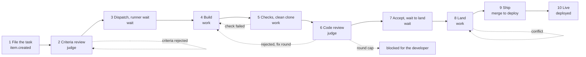

# The process map

`GET /p/NAME/process` is the Process tab of a project's Activity area, beside
Flow. It draws the whole task flow as a flowchart, with the time tasks spend in
each block and how often each loop runs. `src/process.ts` builds it and
`src/process.css` styles it; the approved mockup is
`docs/design/process-map/a-process-map.html`, with its renders at 1280 and 390
wide, light and dark.

The page computes nothing the flow report does not. Its phases, shares and
rates are `computeFlow` in `src/flow.ts` (defined in [flow.md](flow.md)) for the
tasks filed in the window; its deploy figures are `computeBars` and
`deployedMerges` from the same file. The page adds only the loop counts that
report does not hold, and the median and p90 of each phase over the tasks.

## The window and the statistic

`?since=7d` (the default) or `?since=30d` picks the window: the tasks filed in
the last 7 or 30 days. `?stat=median` (the default) or `?stat=p90` picks the
statistic each block leads with; the other is on its second line. Any other
value is the default. Both are plain links, so the page needs no JavaScript.
"Previous" in the headline cards is the same length of time before the window.

The page reads the project's events back to the start of the previous window,
then reads on its own each task seen there whose filing is older. A task filed
20 days ago and deployed today is therefore timed from filing, as
`atelier flow --bars` times it, in the 7-day page too.

## Blocks

A block shows the median and p90 minutes, the number of tasks that entered it
and its share of all measured time. A task entered a phase when the phase is
known for it and has time or is still open. The medians use the mean of the two
middle values for an even count and p90 is the nearest rank, as in
`atelier flow --bars`. A block no task entered, or a window with no tasks,
says "no tasks".

| Block | Measures | Where the number comes from |
| --- | --- | --- |
| 1 File the task | tasks filed in the window with a full record | `report.counted` |
| 2 Criteria review | time from `criteria_review.requested` to its verdict | phase `criteriaReview` |
| 3 Dispatch, runner wait | `item.dispatched` to `item.claimed`; includes core-file holds, which the ledger does not record apart | phase `runnerWait` |
| 4 Build | claim or handoff to the first push | phase `build` |
| 5 Checks, clean clone | push to submit, and the checks on the merge | phase `checks` |
| 6 Code review | `item.submitted` to the first verdict | phase `reviewWait` |
| 7 Accept, wait to land | `review.approved` to the first check on the merge; the two phases added per task | phases `accept` and `waitToLand` |
| 8 Land | `landing.begun` to `item.merged` | phase `merge` |
| 9 Ship | measured: `item.merged` to the deploy step's `action.ran` of the ship that deployed it, for merges in the window | `deployedMerges`; deploys counted as `atelier flow --bars` counts them |
| 10 Live | merges in the window that have a deploy, of all merges in it | the same merges as Ship |

A merged task with no deploy yet is counted ("N merged, not deployed") and
named under the map; it has no merge-to-deploy time and is not in the median.

## Loops

Each loop shows its events and the tasks they fall in. The arrow is drawn
heavier the more events there are.

| Loop | Counts | Source |
| --- | --- | --- |
| rejected, fix round | `review.rejected` events | `rejections` of each task in the report |
| check failed | `evidence.*` events whose check did not pass, and `refresh.checks_failed` | `checkFailures` of each task, as [flow.md](flow.md) counts them |
| conflict | `refresh.returned`, `integration.failed`, and a handback while accepted work waited to land | `conflicts` of each task |
| criteria rejected | `criteria_review.rejected` events | the window's tasks' events |
| round cap | tasks the ledger held after the cap of rejected rounds (`review.round_cap`, logged once per hold) | the window's tasks' events |

## Headline cards

- Filed to deployed, median and p90: `item.created` to the deploy, against the
  60 minute and 3 hour targets, as `atelier flow --bars` computes them, over
  merges in the window.
- Filed to merged, median: `medianMinutesToMerge` of the report.
- Review rounds per task, median: `medianReviewRounds` (submissions per task),
  with the mean over the same tasks.

Each shows the previous window's value, or "no tasks" for it.

## Not checked locally

The page's render time against the atelier project's own ledger at 30 days is
checked after deploy; the commit message holds the local measurement on a
ledger built to that size.
